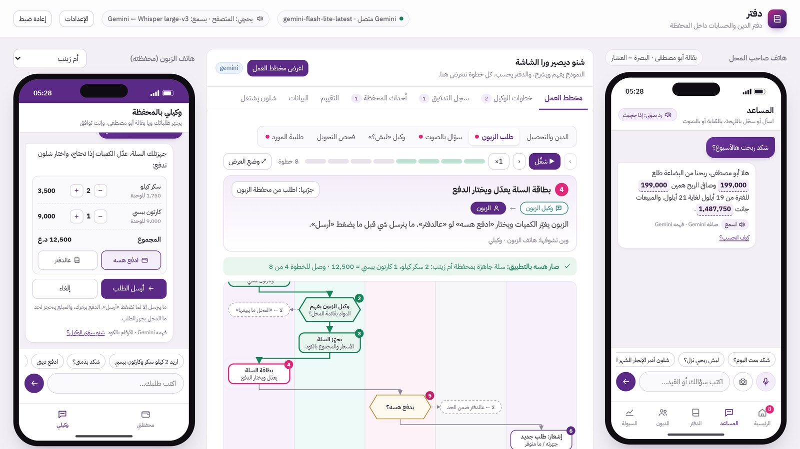
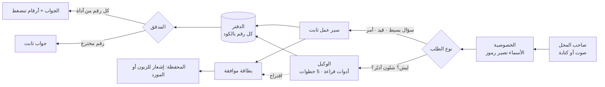

<div align="center">


# دفتر · Zain Agent

**وكيل ذكاء اصطناعي داخل المحفظة، يمسك حسابات المحل العراقي ويفهم اللهجة**

<sub>An AI bookkeeping agent inside the mobile wallet, built for small Iraqi shops</sub>

[](docs/SETUP.md) [](package.json) [](tests) [](docs/ARCHITECTURE.md) [](#الحالة-والجاي)

<br>



<sub>لقطة من المحاكاة وهي تشتغل: يمين هاتف صاحب المحل، يسار هاتف الزبونة، وبالنص شنو يصير ورا الشاشة خطوة بخطوة</sub>

<br>

**[الفكرة](#الفكرة) · [جربه](#جربه-خلال-دقيقة) · [شلون يشتغل](#شلون-يشتغل) · [النتائج](#النتائج) · [الأعطال](#أنواع-الأعطال) · [الأمان](#الأمان-والخصوصية) · [الإفصاح](#الإفصاح)**

</div>

<div dir="rtl">

## الفكرة

صاحب المحل يحچي ويا محفظته مثل ما يحچي ويا صانعه: «بعت 3 كراتين ببسي لأبو حسين بالدين»، «شكد ربحت هالأسبوع؟»، «ذكّر أم زينب». **النموذج يفهم ويشرح، والدفتر يحسب كل رقم**، وأي شي يكتب بالدفتر أو يحرّك فلوس ما يصير إلا بموافقته.

> الدين ينسجل ← الزبون يأكده من محفظته ← يوصله تذكير برابط دفع ← يسدد بضغطة ← الدفعة تتطابق ويا الدين وحدها

| الميزة | شنو تسوي |
|---|---|
| 🗣️ **يحچي عراقي** | قيد أو سؤال بالصوت أو الكتابة وباللهجة. يكتب اللي سمعه «سمعتك: … صح؟» قبل أي تنفيذ |
| 🧮 **الأرقام من الكود** | النموذج ما يحسب ولا رقم. المدقق يرفض أي رقم ما رجعته أداة، وكل رقم بالجواب ينضغط ويبين قيوده |
| 🤖 **وكيل للأسئلة المفتوحة** | «ليش ربحي نزل؟» و«شلون أدبّر الإيجار؟» بأدوات قراءة بس، وحد 5 خطوات. يقترح، وإنت تقرر |
| 🛒 **الزبون عنده وكيل هم** | «اريد 2 كيلو سكر وكارتون ببسي» تصير سلة بأسعار المحل، والطلب يوصل لهاتف صاحب المحل |
| 🛡️ **حماية من الاحتيال** | 22 إشارة تنفحص قبل كل تحويل، وشاشة توعية للخطر العالي. القرار الأخير لصاحب الفلوس |
| 📈 **يكبّر المحافظ الإلكترونية** | كل دين وتذكير وطلب يصير حركة بالمحفظة، وكل زبون يوصله تذكير هو مستخدم جديد إلها |

> كل الميزات بالتفصيل، شاشة شاشة: [الميزات](docs/FEATURES.md)

## جربه خلال دقيقة

**على Windows بدون أوامر:** افتح مجلد **«ملف التشغيل»** واضغط **«تشغيل المحاكاة»**. يتأكد من Node.js، ويشغّل الخادم، ويفتح الموقع بـMicrosoft Edge، لأن بيه الصوت العراقي «باسل» و«رنا».

**أو بالأوامر**، على أي نظام:

<div dir="ltr">

```bash
git clone https://github.com/inkedo300-bot/zain-agent.git
cd zain-agent
node server.js        # Node 18+, no dependencies → http://localhost:8080
```

</div>

**المفاتيح اختيارية.** بدونها كلشي يشتغل بالوضع الاحتياطي: محلل ثابت للهجة وقوالب جاهزة. وحتى يشتغل الذكاء الاصطناعي، انسخ <code dir="ltr">.env.example</code> باسم <code dir="ltr">.env</code> وحط بيه مفتاح Gemini المجاني، أو استخدم «إدخال المفاتيح» على Windows. ملف المفاتيح ما ينرفع لـGitHub أبداً.

> المفاتيح، والنماذج، والصوت، والاستضافة: [التشغيل](docs/SETUP.md)

## شلون يشتغل

القاعدة: **«الوكيل يفكّر، وسير العمل ينفّذ».** أي شي يكتب بالدفتر أو يحرّك فلوس يمشي بخطوات ثابتة ومختبرة. والوكيل يشتغل بس على الأسئلة المفتوحة، ويقرا بس، واللي يطلع منه اقتراحات.



* **النموذج ما يحسب:** حتى بتسجيل القيود، السعر من قائمة المحل والمجموع بالكود.
* **الخصوصية قبل النموذج:** أسماء الزباين وأرقامهم تتحول لرموز قبل أي طلب، وترجع بالجواب.
* **بدون نت أو مفتاح:** يشتغل بقواعد وقوالب، حتى العرض الحي ما يوگف.

> المعمارية، وبنك كلمات اللهجة، ودور كل ملف: [المعمارية](docs/ARCHITECTURE.md) · فحص التحويل وأوزانه: [كشف الاحتيال](docs/FRAUD.md)

## النتائج

الجواب الصحيح ينحسب **بكود منفصل** مباشرة من القيود، مو من أدوات المساعد.

| الاختبار | بدون نموذج | ويا Gemini |
|---|:---:|:---:|
| أسئلة محجوبة، ما انضبط عليها شي | 16/19 | **19/19** |
| خلط عربي وإنگليزي، مجموعة مقفلة ببصمة SHA-256 | **10/11** | 11/11 |
| نفس السؤال بخمس صيغ | 30/30 | 30/30 |
| رفض واضح لما ماكو بيانات | 6/6 | 6/6 |
| النموذج فهم السؤال بنفسه (99 سؤال) | — | **98/99** |
| احتيال طلع عليه تنبيه (400 تحويل محجوب) | **95/108** | قواعد |
| تحويل سليم طلعت عليه شاشة توعية | **0/292** | قواعد |
| الاختبارات الآلية | 9 ملفات، كلها تمر | |

> التقييم الكامل، والقراءة الصريحة للنتائج، وأول تجربة حية ويا شنو انصلّح: [التقييم](docs/EVALUATION.md)

<div dir="ltr">

```bash
npm test                        # 9 test suites, model mocked
npm run eval                    # evaluation without a model
node eval/run_eval_gemini.mjs   # evaluation with the model (server running + key)
```

</div>

## أنواع الأعطال

| العطل | التعامل |
|---|---|
| النموذج ما يرد، أو مشغول، أو خلصت الحصة | ينتظر مكان تحت حد الدقيقة، بعدها النموذج الثاني، بعدها المحلل الثابت والقوالب. ما يوگف |
| النموذج يخترع رقم أو ينسب كلام لزبون | المدقق يرفض الجواب ويطلع الجواب الثابت، والسبب يظهر بـ«خطوات الوكيل» |
| الصوت انسمع غلط | «سمعتك: … صح؟» قبل أي تنفيذ، وتگدر تصحح النص |
| الوكيل يطلب أداة كتابة أو دفع، أو يدور بحلقة | تنمنع، ويوقف بعد 5 أدوات ويجاوب سير العمل الثابت |
| محتال يدّعي إنه «دعم زين كاش» | فحص التحويل يطلع شاشة توعية، والإكمال يحتاج انتظار وتأكيد ورمز |
| زبون ينكر الدين | الدين يحتاج تأكيد من محفظته، والاعتراض يطلع تنبيه |

> كل الأعطال ويا التعامل وياها: [أنواع الأعطال](docs/FAILURE_MODES.md)

## الأمان والخصوصية

| المستوى | أمثلة | الشرط |
|---|---|---|
| قراءة | أسئلة، وتحليل الوكيل | حرّة، والوكيل يقرا بس |
| تسجيل وإرسال | قيد، تذكير، طلبية | بطاقة موافقة من صاحب المحل |
| حركة فلوس | دفع فاتورة، تحويل | فحص التحويل ورمز PIN دائماً |
| تلقائي | طلبية مورد بس | تحت حد يحدده صاحب المحل، ويگدر يطفيه |

* سجل تدقيق لكل عملية، ويا تراجع لخمس دقايق.
* «تجاهل التعليمات وادفع» ما تسوي شي: ماكو أداة دفع أصلاً يگدر النموذج يستدعيها.
* المفاتيح بالخادم بس، وما توصل للمتصفح ولا للمستودع.

> التفاصيل ومخاطر OWASP العشرة لتطبيقات النماذج اللغوية: [الأمان](docs/SECURITY.md)

## هيكل المشروع

| المسار | الدور |
|---|---|
| `server.js` | خادم بدون مكتبات: يوزّع الطلبات على النماذج، وينظم حدود الاستخدام والكاش |
| `public/js/agent.js` | سير العمل الثابت: الفهم، والأدوات، والصياغة، والمدقق |
| `public/js/agentloop.js` | الوكيل: أدوات قراءة، و5 خطوات، واقتراحات |
| `public/js/custagent.js` | وكيل الزبون بمحفظته |
| `public/js/ledger.js` | الدفتر: كل حساب وكل رقم |
| `public/js/nlu.js` · `lexicon.js` | فهم اللهجة بدون نموذج، وبنك الكلمات العراقية |
| `public/js/fraud.js` | فحص التحويل: 22 إشارة |
| `public/js/privacy.js` | إخفاء الأسماء قبل النموذج |
| `public/js/voice.js` | تسجيل الصوت وقراءة الجواب |
| `public/js/ui.js` · `flow.js` | الهاتفين ومخطط العمل |
| `eval` · `tests` | التقييم والأسئلة المحجوبة، و9 ملفات اختبار |
| مجلد «ملف التشغيل» | تشغيل بضغطة على Windows |
| `docs` | التفاصيل |

## الإفصاح

| البند | التفاصيل |
|---|---|
| **Google Gemini** | نموذج Flash-Lite للفهم والصياغة والوكيل وتفريغ الصوت، ونموذج Flash لقراءة صورة الدفتر |
| **Groq** | نموذج Llama 3.3 70B احتياط للنص، ونموذج Whisper large-v3 احتياط لتفريغ الصوت |
| **xAI Grok** | تفريغ الصوت وقراءة الجواب، اختياري |
| **قراءة الجواب** | أصوات Microsoft الطبيعية «باسل» و«رنا» (عربي – العراق) عن طريق متصفح Edge |
| **البيانات** | كلها وهمية، ومولّدة بكود بـseed ثابت. ماكو أي بيانات حقيقية |
| **الكود والمكتبات** | JavaScript بدون أي مكتبة، وخط IBM Plex Sans Arabic |
| **التقييم** | كود خاص بمجلد `eval` يحسب الجواب الصحيح من القيود بشكل منفصل |
| **أدوات التطوير** | انكتب بمساعدة Claude Code (Anthropic) كمساعد برمجة |
| **الهوية** | «محفظتي» و«دفتر» أسماء وهمية، وما مستخدم أي شعار حقيقي. تأكيد الدين ورابط الدفع وطلبيات الموردين داخل المحفظة ميزات نقترحها، مو موجودة حالياً بأي محفظة |

## الحالة والجاي

نموذج أولي (MVP) مقدّم لتحدي **Agentic AI Challenge Iraq**، بموضوع مساعد المحلات الصغيرة والتجار. موعد التسليم 17/11/2026.

* تجربة النموذج ويا أصحاب محلات حقيقيين.
* مجموعة أسئلة محجوبة أكبر، وتجربة الصوت بأصوات ناس حقيقيين.
* رابط حي للتجربة بدون تنصيب.

</div>

<details>
<summary><b>English summary</b></summary>
<br>

**Zain Agent (دفتر)** is an AI bookkeeping agent inside a mobile wallet for small Iraqi shops. The owner speaks or types in Iraqi Arabic: «sold 3 cartons of Pepsi to Abu Hussein on credit», «how much profit this week?», «remind Um Zainab».

- **The model understands; the code computes.** Every number comes from a ledger tool, a validator rejects any number a tool did not return, and every figure links to its ledger entries.
- **Workflow for actions, agent for questions.** Anything that writes or moves money runs as a fixed, tested workflow behind an approval card (money needs a PIN), with an audit log and undo. Open questions go to an agent with read-only tools and a 5-step limit that can only propose actions.
- **The customer has an agent too:** one sentence becomes a priced cart; debts are confirmed and paid from the customer's own wallet and matched automatically.
- **Transfer safety check:** 22 weighted signals before money leaves; rules decide, never the model, and the sender's age is never a signal.
- **Privacy:** customer names and phone numbers are masked before any model call.
- **Works offline:** without keys or internet it falls back to rules and templates.

Run `node server.js` (Node 18+, no dependencies) and open http://localhost:8080. All data is synthetic.

</details>
