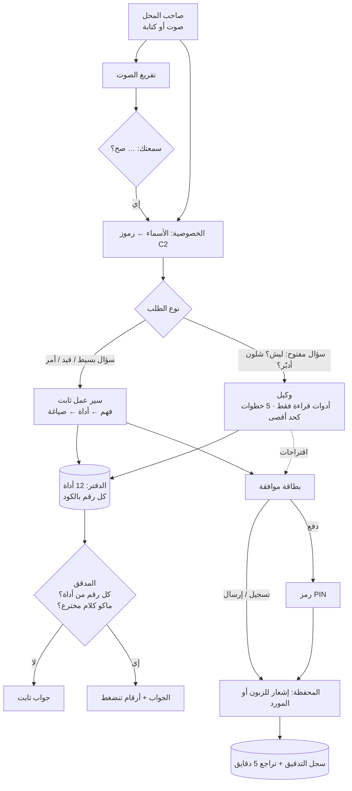

[← الرئيسية](../README.md)

# المعمارية: وكيل + سير عمل

القاعدة: **«الوكيل يفكّر، وسير العمل ينفّذ».** أي شي يكتب بالدفتر أو يحرك فلوس يمشي بخطوات ثابتة نگدر نختبرها. والوكيل يشتغل بس على الأسئلة المفتوحة، ويقرا بس، وكل اللي يطلع منه **اقتراحات**.

| | سير العمل الثابت | الوكيل |
|---|---|---|
| متى | «شكد بعت اليوم؟»، «بعت لأم زينب بالدين»، «ذكّر أبو علي» | «ليش ربحي نزل؟»، «شلون أدبّر الإيجار والمورد؟» |
| منو يقرر الخطوات | الكود | النموذج (أدوات قراءة فقط) |
| يگدر يكتب أو يدفع؟ | بس ويا بطاقة موافقة، والدفع برمز | لا. يقترح بس، والاقتراح زر يبدي سير العمل الثابت |
| حد الخطوات | ثابت | 5 أدوات كحد أقصى |
| إذا النموذج فشل | المحلل الثابت والقوالب | سير عمل «ليش» ثابت (مقارنة آخر 7 أيام بالسبعة اللي قبلها) |

* **النموذج ما يحسب أي رقم.** حتى بتسجيل القيود، السعر من قائمة المحل. أداة `compare` تحسب الفرق بالكود حتى الوكيل ما يطرح بنفسه.
* **المدقق:** يرفض أي رقم ما رجعته أداة، وأي جواب نسي الرقم الأساسي، وأي كلام منسوب لزبون («گالت رح تدفع») أو ادعاء إنه سوّى شي.
* **رفض النموذج ما يغلب القواعد:** إذا النموذج رفض سؤال، والمحلل الثابت لگاه سؤال مخزون أو زبون أو طلبية واضح، يجاوب المحلل.
* **ذاكرة المحادثة:** المساعد يتذكر آخر زبون وآخر مورد وآخر سؤال، فـ«ذكّرها» و«والبارحة؟» و«اطلب على أي حال» تنفهم بدون تكرار. والنموذج ينطى السؤال السابق، والأسماء مخفية.
* **التوقع حساب على الدفتر:** المعدل حسب يوم الأسبوع، وأيام الرواتب، وبضاعة الموردين، والمصاريف الثابتة، والدفعات المعروفة، والتحصيل حسب عادة كل زبون.

## الملفات

| الملف | الدور |
|---|---|
| `public/js/data.js` | مولّد البيانات الوهمية: محل واحد، 90 يوم، 10 زباين، 3 موردين، دولار يتغير، و8 شذوذات مزروعة |
| `public/js/ledger.js` | الأدوات والحساب: توقع، شذوذات، تسكيرة، مخزون، طلبية |
| `public/js/nlu.js` | فهم اللهجة بدون نموذج: الفترات، والأرقام بالكلام مثل «خمسة وعشرين الف»، والقيود، والأوامر، وتكملة الكلام |
| `public/js/lexicon.js` | بنك كلمات اللهجة العراقية |
| `public/js/agent.js` | سير العمل الثابت: التوجيه، والصياغة، والقيود، وقراءة الصور، والتذكير، والمدقق، وتفريغ الصوت |
| `public/js/agentloop.js` | الوكيل: حلقة أدوات القراءة، وحد الخطوات، والاقتراحات، وسير عمل «ليش» الاحتياطي |
| `public/js/custagent.js` | وكيل الزبون بمحفظته: يفهم الطلب، ويجهّز السلة أو الدفعة بالكود، ويشوف بس بيانات الزبون نفسه |
| `public/js/privacy.js` | إخفاء الأسماء والهواتف قبل أي طلب للنموذج، وإرجاعها بالجواب |
| `public/js/fraud.js` · `fraud_data.js` | فحص التحويل وبياناته التجريبية |
| `public/js/orders.js` | طلبيات الموردين: متى تنكتب، ومتى تنرسل وحدها، ومراحلها |
| `public/js/voice.js` | تسجيل الصوت WAV (16 kHz)، واختيار صوت قراءة الجواب |
| `public/js/flow.js` | مخطط العمل: السيناريوهات والرسم (SVG) |
| `public/js/ui.js` | الهاتفين واللوحة |
| `public/js/eval.js` | التقييم |
| `server.js` | خادم بدون مكتبات: يوزّع الطلبات بين النماذج، وينظم حدود الاستخدام، والكاش، والسجل |

## بنك كلمات اللهجة العراقية

`public/js/lexicon.js` بيه **208 مدخل وحوالي 1000 صيغة**، مثل ما ينحچون بالمحل: كلمات السؤال («جم»، «شكثر»، «بيش»)، والوقت («هسع»، «باچر»، «الشهر الياي»)، والفلوس والدولار («الأخضر»، «البورصة»، «ورقة»)، والدين والسداد («عالدفتر»، «خليها عليه»، «صفّى حسابه»)، والمصاريف («الكري»، «الأمبيرات»)، والمخزن («الستوك»، «ضايل»، «خلصان»)، وكلمات الاحتيال («قفّاص»، «دزلي الكود»)، و97 كلمة أرقام («ثنعش»، «خمسطعش»، «عشرت تالاف»، «الف ونص»)، و34 كلمة إنگليزية شائعة بالمحل (sales، profit، cash…). وإذا گال «انطاني خمسة وعشرين» يفهمها 25,000 ويطلب تأكيد.

ينستخدم بثلاث أماكن:

1. **الوضع الاحتياطي:** `normalizeIraqi()` يحوّل الكلمة للصيغة اللي القواعد تعرفها قبل الفهم («جم بعت هسع بالأمبيرات؟» ← «شكد بعت هسه بالمولده؟»). أسماء الزباين ما تتغير.
2. **تعليمات النموذج:** معجم مختصر ينضاف لموجّه الأسئلة واستخراج القيود، ونسخة أصغر للوكيل.
3. **تفريغ الصوت:** قائمة كلمات لهجة يكتبها مثل ما تنگال بدل ما يحولها للفصحى (`sttHints()`).

النتيجة بالقواعد بدون نموذج: أسئلة لهجة ثقيلة من 6/31 إلى 31/31، وقيود من 3/12 إلى 12/12 (`npm run eval:dialect`). هذي المجموعة انكتبت ويا المعجم، فاختبرناه على 12 سؤال جديد ما انضبط عليهم: من 4/12 إلى 10/12.

تضيف كلمة؟ زيد سطر بالقسم المناسب: `['الصيغة|صيغة ثانية', 'المعنى', 'الكلمة اللي القواعد تعرفها']`، و`npm test` يتأكد ماكو كلمة تتعارض ويا ثانية أو ويا اسم مادة.

